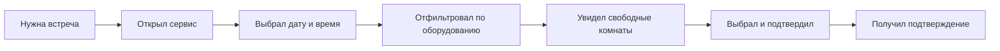

# Требования: «Бронирование переговорных комнат»

## Предметная область

Выбран домен: **сервис бронирования переговорных комнат в бизнес-центре**.

### Проверка кандидатов

| Требование | Кандидат 1: Переговорки | Кандидат 2: Книжный магазин |
|---|---|---|
| 2–3 ограниченных контекста | Помещения · Брони · Тарифы и оплата · Уведомления | Каталог · Заказы (2, на грани) |
| Внешняя интеграция | Платёжный шлюз, календарь (ICS), email/SMS | Только платежи |
| Пользовательский интерфейс | Календарь занятости, карточка комнаты, «Мои брони», админка этажа | Витрина + корзина |
| Нетривиальные данные | Комнаты↔оборудование, статусы броней, история, тарифы по времени | Книги и заказы — почти одна таблица |
| **Вывод** | ✅ проходит | ❌ данных и контекстов мало |

**Итог:** выбран «Бронирование переговорных комнат».

## Постановка проблемы

**Что:** администратор этажа бизнес-центра ведёт брони в таблице и по телефону, из-за этого комнаты сталкиваются, а посетитель узнаёт
о конфликте только на месте, как и о наличии оборудования (проектор, доска).

**Для кого:** сотрудники компаний-арендаторов (10–15 компаний на этаж, до 200 человек) и администратор этажа, который вручную сводит брони.

**Зачем:** сотрудник видит занятость и оборудование комнаты сам и бронирует в один шаг; администратор перестаёт быть диспетчером.

**Как измерим успех:** доля броней, оформленных без участия администратора (цель ≥ 80 % за первый месяц), и число конфликтов «комната занята» за неделю (цель = 0).

## Персоны

### Персона: Пользователь (внутрений и внешний)

**Роль и контекст:** пользователь, организует встречи с сотрудниками или клиентами.
**Цель:** занять переговорку под встречу с нужным оборудованием, не созваниваясь с администратором, подтверждение для приглошонного(-ых).
**Как решает сейчас:** пишет в общий чат «кто занял 3А?», сверяется с Excel, связывается с администратором.
**Боли:**
- не видит занятость заранее, узнаёт о конфликте у двери;
- не знает, есть ли в комнате проектор;
- подтверждение приглашенному(-ым) приходится писать вручную;
- чтобы отменить, снова пишет администратору.
**Что важно:** увидеть свободные комнаты с нужным оборудованием за секунды; отмена в один клик; подтверждение на экране с номером комнаты и этажом.

### Персона: Администратор этажа

**Роль и контекст:** один человек на этаж, параллельно встречает гостей и ведёт таблицу.
**Цель:** не разбирать конфликты и не отвечать на каждый вопрос «свободно ли?».
**Как решает сейчас:** сводит брони из чата в Excel вручную.
**Боли:**
- двойные брони из-за забытых отмен;
- отвлекают на каждый вопрос;
- не видит, какие комнаты простаивают.
**Что важно:** видеть занятость этажа целиком; чтобы сотрудники бронировали сами.

## Путь пользователя

**Персона:** Пользователь. **Сценарий:** забронировать переговорку на завтра с проектором.

1. **Нужна встреча** — вечером планирует завтрашний день
2. **Открыл сервис** — с телефона
3. **Выбрал дату и время** — по умолчанию завтра в 6:00
4. **Отфильтровал по оборудованию** — поставил галачку на наличие проектора в комнате
5. **Увидел свободные комнаты** — что свободно и что занято на эту дату
6. **Выбрал и подтвердил** — два шага, без ввода данных
7. **Получил подтверждение** — номер места, время, кнопка отмены
## Минимально жизнеспособный продукт

**Входит:**
- Просмотр свободных переговорных комнат на выбранную дату и время.
- Фильтрация комнат по наличию оборудования (проектор, доска).
- Бронирование свободного слота в один шаг.
- Подтверждение на экране с номером комнаты и этажом.
- Просмотр списка броней на сегодня для администратора этажа.
- Отмена собственной брони с мгновенным освобождением слота.

**Критерий MVP:** сотрудник может пройти сценарий «нашёл комнату с нужным оборудованием — забронировал — получил подтверждение — пришёл — отменил» без участия администратора.

---

## Вне области охвата этого семестра

| Не делаем | Почему |
|---|---|
| Email/SMS-уведомления и приглашения | Требует настройки внешнего шлюза (интеграция). Для проверки гипотезы достаточно подтверждения на экране; вынесено в R4 (Модуль 12–13). |
| Онлайн-оплата и тарифы | Ценообразование — отдельная предметная область. Требует договора с платёжным шлюзом, не влияет на проверяемую гипотезу. |
| Мобильное приложение | Веб-версия (адаптивная) полностью закрывает сценарий; нативный клиент — отдельный объём разработки. |
| Несколько этажей / бизнес-центров | Усложняет модель данных (иерархия помещений), не влияет на проверку гипотезы для одного этажа. |
| Повтор вчерашней брони | Удобство (v1.1), а не необходимость для прохождения сквозного сценария. |
| Перенос брони на другое время | Сложная логика состояний (v1.1). В MVP достаточно отмены и создания новой брони. |
| Отметка по QR-коду | Физическая интеграция (v1.2), не влияет на основную ценность — разрешение конфликтов бронирования. |
| Интеграция с календарём (ICS) | Удобство, а не необходимость. Вынесено за рамки семестра. |
